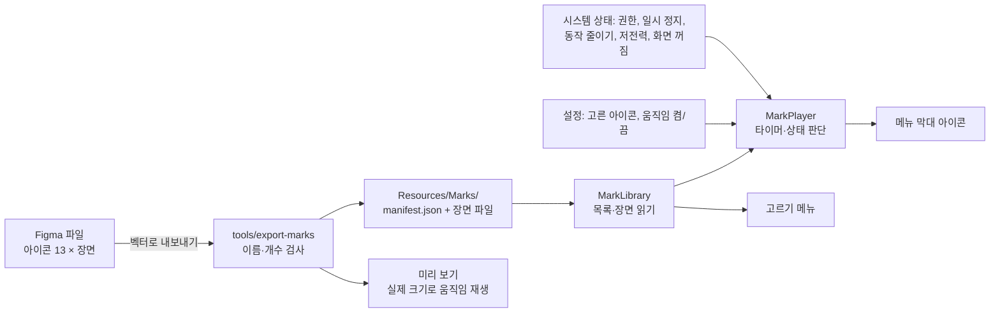

# Layerhover 메뉴 막대 아이콘 — 기능 기획안

- 상태: **구현 완료 (1.5.0)** · 작성일 2026-11-13 · 구현·검증 2026-11-16 · 14절에 결과
- 범위: 기획만. 이 문서가 승인되기 전에는 아이콘 코드를 더 고치지 않는다.

---

## 0. 인터뷰에서 확정한 결정

| # | 질문 | 결정 |
|---|---|---|
| D1 | 아이콘의 가장 중요한 역할 | 보는 순간 마음이 놓이는 것 (기능 표시보다 정서가 우선) |
| D2 | 지금 아쉬운 품질 | 그림 완성도, 아이콘 간 통일감, 움직임 |
| D3 | 움직이는 시점 | 항상, 아주 천천히 |
| D4 | 그림 방식 | 채운 실루엣으로 통일 |
| D5 | 원본 제작 위치 | Figma에서 그리고 앱으로 가져온다 |
| D6 | 움직임 크기 | 보면 바로 알 수 있는 정도 |
| D7 | 추가 기능 | 없음. 고르기만 둔다 |
| D8 | 움직임 제작 | 장면을 여러 장 그린다 (장면 넘기기) |
| D9 | 그리는 사람 | Claude가 Figma에서 끝까지 그리고, 사용자는 승인만 한다 |
| D10 | 반영 범위 | 13개 모두 기준을 통과한 뒤 한 번에 반영 |

---

## 1. 개요

### 기능 설명
macOS 메뉴 막대에 놓이는 Layerhover 아이콘을 "마음의 평화"를 주는 그림 13종 가운데 사용자가 고르고, 고른 그림이 늘 느리게 움직인다.

### 해결하는 문제
1. Figma 작업은 긴장과 스트레스가 크다. 화면 한구석에 잠깐 눈을 둘 평온한 지점이 없다.
2. 1.4.x의 아이콘은 한 개씩 고쳐 가며 만들어서 세 가지가 부족하다.
   - 그림 완성도: 실제 크기에서 무엇인지 바로 읽히지 않는 그림이 있다 (서핑, 백합).
   - 통일감: 면으로 그린 것(좌불상, 돌탑)과 선으로 그린 것(파도, 향)이 섞여 한 세트로 보이지 않는다.
   - 움직임: 그림마다 움직임의 크기와 성격이 달라 기준이 없다.
3. 아이콘을 고칠 때마다 앱을 다시 빌드했고, 그때마다 손쉬운 사용 권한을 다시 허용해야 했다.

### 대상 사용자
Figma 데스크톱 앱으로 하루 여러 시간 작업하는 디자이너. 메뉴 막대를 자주 보지는 않지만 시야 끝에 늘 걸려 있다.

### 가치
- 사용자: 고개를 들었을 때 잠깐 숨을 고르게 하는 작은 쉼터.
- 제품: "디자이너가 만든 도구"라는 인상. 기능이 같은 다른 도구와 구분되는 정체성.

### 성공 기준
| 지표 | 기준 |
|---|---|
| 판독 | 13개 모두, 이름을 가린 실제 크기(18pt, 2배 화면) 그림을 보고 사용자가 무엇인지 맞힌다 |
| 통일감 | 13개 모두 3.2절 그림 규칙 검사에서 위반 0건 |
| 움직임 | 13개 모두 3.3절 움직임 규칙 검사에서 위반 0건, 사용자가 미리 보기에서 13개 모두 승인 |
| 부하 | 움직이는 동안 Layerhover의 CPU 사용량 증가가 60초 평균 0.5%p 이하 (Apple Silicon) |
| 재작업 | 아이콘 반영을 위한 앱 빌드·권한 재허용 1회 |

---

## 2. 아이콘 13종 정의

모든 아이콘은 **주인공 하나 + 움직이는 부분 하나**로 구성한다. 움직이는 부분이 둘이면 둘째는 첫째보다 작게 움직인다.

| ID | 이름 | 정지 장면 (장면 00) | 움직임 | 한 바퀴 | 장면 수 |
|---|---|---|---|---|---|
| `buddha` | 좌불상 | 가부좌로 앉은 정면 실루엣. 광배 없음. 무릎 위에 모은 팔을 파내어 표현 | 숨: 어깨와 머리가 1pt 올라갔다 내려온다 | 5초 | 40 |
| `wave` | 일어나는 파도 | 평평한 수면에서 솟아 한 번 말리는 파도. 수면과 파도가 한 덩어리 실루엣 | 파도 머리가 앞으로 2pt 밀렸다가 돌아오고, 말린 끝이 따라 감긴다 | 4초 | 32 |
| `surf` | 서핑 | 비스듬한 파도 면 위에 보드와 웅크린 사람 | 보드와 사람이 함께 1.5pt 오르내리며 6도 기울어진다 | 4초 | 32 |
| `fishing` | 앉아서 낚시 | 물가 판자에 앉은 사람, 낚싯대, 찌 | 찌가 1.5pt 까딱이고 낚싯대 끝이 0.5pt 휜다 | 4초 | 32 |
| `tree` | 크리스마스 나무 | 세 단 삼각형 나무와 줄기 | 파낸 점 세 개(불빛)가 차례로 커졌다 작아진다 | 3초 | 24 |
| `magnolia` | 목련 | 맨가지 위에 잔 모양으로 핀 꽃 한 송이(둥근 꽃잎 세 장)와 옆 가지의 꽃봉오리 | 가지 밑동을 축으로 3.2도 살랑인다 | 4초 | 32 |
| `lotus` | 연꽃 | 정면 꽃잎 다섯 장, 아래 수면 | 바깥 꽃잎이 6도 벌어졌다 오므린다 | 4초 | 32 |
| `cairn` | 네모 돌탑 | 모서리 둥근 네모 돌 네 개를 어긋나게 쌓음 | 맨 위 돌이 1.5pt 떠올랐다 내려앉는다 | 4초 | 32 |
| `incense` | 향 | 긴 접시 위에 가로로 누운 향, 한쪽 끝 불씨 | 불씨에서 연기가 물결치며 올라가 위에서 옅어진다 | 4초 | 32 |
| `moon` | 물 위의 보름달 | 꽉 찬 달(파낸 무늬 2개), 수면, 비친 달빛 두 줄 | 달빛 두 줄의 길이가 엇갈려 2pt 늘었다 줄어든다 | 4초 | 32 |
| `cat` | 잠든 고양이 | 몸을 둥글게 만 고양이, 귀, 몸을 감싼 꼬리 | 등이 1pt 오르내리고, 한 바퀴에 두 번 꼬리 끝이 1pt 까딱인다 | 5초 | 40 |
| `leaf` | 나뭇잎 | 잎맥을 파낸 잎 한 장과 잎자루 | 잎자루 끝을 축으로 6도 살랑인다 | 4초 | 32 |
| `peek` | 옆에서 나오는 패널 | 왼쪽 끝선과 거기서 나온 둥근 패널 (이 앱의 동작) | 패널이 끝선에서 나와 2초 머문 뒤 들어간다. 정지 장면은 다 나온 모습 | 5초 | 40 |

합계 432장면. 재생 속도는 13개 모두 초당 8장면.

---

## 3. 품질 기준

### 3.1 격자
- 캔버스 18×18pt. 그림은 가운데 16×16pt 안에만 그린다 (바깥 1pt는 비운다).
- 움직이는 장면도 16×16pt를 넘지 않는다.
- 땅·수면·받침이 있는 그림은 그 아랫변을 y=2pt에 맞춘다.

### 3.2 그림 규칙 (채운 실루엣)
| 규칙 | 값 |
|---|---|
| R1 채움 | 모든 형태는 면으로 채운다. 선(stroke) 속성은 쓰지 않고, 가는 것(낚싯대, 향, 수면)도 닫힌 면으로 그린다 |
| R2 최소 굵기 | 채운 부분의 가장 가는 곳 1.0pt 이상 |
| R3 최소 틈 | 파낸 부분과 형태 사이 틈 1.0pt 이상 |
| R4 모서리 | 바깥 모서리 반지름 0.5pt 이상. 뾰족해야 뜻이 통하는 곳(귀, 나무 꼭대기, 잎끝)만 예외 |
| R5 안쪽 표현 | 안쪽 디테일은 파내서 표현한다. 아이콘 하나에 파낸 곳 3개 이하 |
| R6 무게 | 16×16pt 영역 중 칠해진 비율 25% 이상 45% 이하 |
| R7 투명도 | 100%만 쓴다. 사라지는 것(향 연기 윗부분) 한 가지만 40%까지 허용 |
| R8 색 | 단색. 앱이 템플릿 이미지로 써서 밝은 막대·어두운 막대에 맞춰 자동으로 칠한다 |

### 3.3 움직임 규칙
| 규칙 | 값 |
|---|---|
| M1 크기 | 가장 크게 움직이는 점의 이동 거리 1.0pt 이상 3.0pt 이하 (회전은 가장 먼 점 기준, `peek` 제외) |
| M2 이음 | 마지막 장면 다음에 장면 00이 와도 끊김이 없다 (이웃 장면 사이 이동 0.4pt 이하, `peek`는 1.5pt 이하) |
| M3 빠르기 | 속도가 사인 곡선을 따른다 (양 끝에서 느려진다). 갑자기 멈추거나 튀지 않는다 |
| M4 고정 | 주인공의 받침(땅, 수면, 접시)은 모든 장면에서 같은 자리에 있다 |
| M5 깜빡임 | 한 장면 사이에 칠해진 넓이가 5% 넘게 변하지 않는다 (`peek` 제외) |
| M6 정지 장면 | 장면 00만 봐도 무엇인지 알 수 있다 |

`peek`는 패널이 통째로 드나드는 그림이라 M1과 M5를 적용하지 않는다. 대신 나오고 들어가는 데 각각 1초, 머무는 데 2초를 쓴다.

---

## 4. 기능 요구사항 (EARS)

**표시**
- **FR-001** 앱은 사용자가 고른 아이콘을 메뉴 막대에 18pt 템플릿 이미지로 보여 준다.
- **FR-002** 아이콘을 고른 적이 없으면, 앱은 `buddha`를 보여 준다.
- **FR-003** 저장된 아이콘 ID가 13종에 없는 값이면, 앱은 `buddha`를 보여 주고 저장값을 `buddha`로 바꾼다.

**고르기**
- **FR-004** 사용자가 메뉴에서 "메뉴 막대 아이콘"을 열면, 앱은 13종을 2절 표의 순서로, 각 항목에 정지 장면과 이름을 붙여 보여 주고 지금 고른 항목에 체크 표시를 한다.
- **FR-005** 사용자가 항목을 고르면, 앱은 100ms 안에 메뉴 막대 아이콘을 바꾸고 그 선택을 저장한다.
- **FR-006** 앱을 다시 켜면, 앱은 마지막으로 고른 아이콘을 보여 준다.

**움직임**
- **FR-007** 움직임이 켜져 있고 앱이 동작 중인 동안, 앱은 고른 아이콘의 장면을 초당 8장면으로 끝없이 되풀이해 보여 준다.
- **FR-008** 사용자가 "아이콘 움직임"을 끄면, 앱은 장면 00에서 멈추고 그 설정을 저장한다. 기본값은 켜짐이다.
- **FR-009** macOS의 "동작 줄이기"가 켜져 있는 동안, 앱은 장면 00만 보여 준다.
- **FR-010** macOS의 "저전력 모드"가 켜져 있는 동안, 앱은 장면 00만 보여 준다.
- **FR-011** 화면이 꺼지거나 잠기면, 앱은 장면 넘기기를 멈추고, 화면이 다시 켜지면 이어서 넘긴다.

**앱 상태**
- **FR-012** 앱이 일시 정지된 동안, 앱은 장면 00을 흐리게(시스템의 비활성 표시) 보여 준다.
- **FR-013** 손쉬운 사용 권한이 없는 동안, 앱은 고른 아이콘 대신 경고 삼각형을 보여 준다.
- **FR-014** 권한이 생기면, 앱은 2초 안에 고른 아이콘으로 돌아온다.

**오류**
- **FR-015** 고른 아이콘의 장면 파일을 읽지 못하면, 앱은 `buddha`를 보여 주고 문제 기록에 아이콘 ID와 파일 이름을 남긴다.
- **FR-016** `buddha`의 장면 파일도 읽지 못하면, 앱은 코드로 그린 대체 그림(끝선과 패널)을 움직임 없이 보여 준다.
- **FR-017** 일부 장면만 읽지 못하면, 앱은 그 아이콘을 장면 00으로 멈춰 보여 주고 문제 기록에 남긴다.

---

## 5. 비기능 요구사항

| ID | 항목 | 기준 |
|---|---|---|
| NFR-001 | CPU | 움직이는 동안 증가분 60초 평균 0.5%p 이하 (Apple Silicon, Figma가 앞에 있을 때) |
| NFR-002 | 메모리 | 고른 아이콘의 장면만 메모리에 둔다. 장면 보관에 쓰는 메모리 4MB 이하 |
| NFR-003 | 용량 | 장면 파일 전체가 앱 용량을 2MB 넘게 늘리지 않는다 |
| NFR-004 | 선명도 | 1배 화면과 2배 화면 모두에서 흐림 없이 그려진다 (벡터 원본) |
| NFR-005 | 테마 | 밝은 막대, 어두운 막대, 색이 있는 배경화면 위에서 모두 보인다 (템플릿 이미지) |
| NFR-006 | 접근성 | 화면 읽기 프로그램에 "Layerhover"로 읽힌다. 움직임은 뜻을 전달하는 데 쓰지 않는다 |
| NFR-007 | 호환 | macOS 13 이상, Apple Silicon과 Intel |
| NFR-008 | 한·영 | 아이콘 이름과 메뉴 문구는 한국어와 영어를 모두 갖춘다 |

---

## 6. 아키텍처

### 패턴
**미리 만든 장면을 넘기는 방식 (flipbook)**. 그림과 움직임은 모두 Figma에서 완성하고, 앱은 파일을 읽어 순서대로 보여 주기만 한다. 앱 안에는 그림을 계산하는 코드를 두지 않는다 (FR-016의 대체 그림 하나 제외).



### 구성 요소
| 구성 요소 | 하는 일 |
|---|---|
| Figma 원본 | 아이콘마다 한 줄, 장면마다 18×18 프레임 하나. 프레임 이름 `ID/장면번호` (예: `incense/07`) |
| `tools/export-marks` | Figma에서 장면을 내려받아 `Resources/Marks/ID/NN.pdf`로 저장하고 `manifest.json`을 만든다. 장면 수·이름·크기가 2절 표와 다르면 실패한다 |
| `manifest.json` | 아이콘별 ID, 한·영 이름, 장면 수, 초당 장면 수, 메뉴 순서 |
| 미리 보기 | 내보낸 장면을 실제 크기(1배, 2배)와 8배 크기로, 밝은 막대와 어두운 막대 위에서 움직여 보여 주는 페이지. 앱을 빌드하지 않고 승인받는 수단 |
| `MarkLibrary` | manifest를 읽고, 요청받은 아이콘의 장면만 읽어 템플릿 이미지로 돌려준다. 읽기 실패를 알린다 |
| `MarkPlayer` | 어떤 장면을 보여 줄지 정한다. 4절의 상태 조건을 한곳에서 판단하고 타이머를 켜고 끈다 |

### 결정 기록
| ADR | 결정 | 이유 | 감수하는 것 |
|---|---|---|---|
| ADR-1 | 움직임을 코드로 계산하지 않고 장면을 그려 넘긴다 (D8) | 모든 장면을 Figma에서 눈으로 확인하고 승인할 수 있다 | 장면 432장. 움직임을 고치려면 장면을 다시 내보내야 한다 |
| ADR-2 | 초당 8장면 | 느린 움직임(한 바퀴 3~5초, 이동 3pt 이하)에서는 이웃 장면 차이가 0.4pt 이하라 끊겨 보이지 않고, 타이머 부하가 지금(초당 12)보다 작다 | 미리 보기에서 끊겨 보이면 초당 12장면으로 올리고 장면 수를 1.5배로 늘린다 (미결 O-2) |
| ADR-3 | 장면 파일은 벡터 PDF | macOS가 기본으로 읽고 1배·2배 화면에서 모두 선명하다 | 파일 432개. 용량이 2MB를 넘으면 아이콘별 이미지 한 장(가로로 이어 붙인 PNG, 1배·2배)으로 바꾼다 (미결 O-1) |
| ADR-4 | 고른 아이콘의 장면만 메모리에 둔다 | 13종 전부를 올려 둘 이유가 없다 | 아이콘을 바꿀 때 파일을 읽는다 (FR-005의 100ms 안에 끝나야 한다) |
| ADR-5 | 상태 판단을 `MarkPlayer` 한곳에 모은다 | 1.4.x에서는 권한·일시 정지·움직임 조건이 여러 곳에 흩어져 있었다 | 기존 `refreshIcon` 코드를 옮겨야 한다 |
| ADR-6 | 승인은 미리 보기에서 받고, 앱 빌드는 모두 승인된 뒤 한 번만 한다 (D10) | 빌드할 때마다 권한을 다시 허용해야 한다 | 실제 메뉴 막대에서의 확인이 맨 마지막에 온다 |

---

## 7. 세 관점 설계

### 화면 (Frontend)
- 메뉴 막대: 18pt 템플릿 이미지 하나. 툴팁 "Layerhover".
- 고르기 메뉴: `메뉴 막대 아이콘 ▸` 아래에 13항목(정지 장면 + 이름 + 체크), 구분선, `아이콘 움직임` 켬/끔.
- 메뉴 안의 그림은 움직이지 않는다 (D7: 미리 보기 창 없음).
- 상태별 모습:

| 상태 | 메뉴 막대에 보이는 것 |
|---|---|
| 동작 중 + 움직임 켬 | 고른 아이콘이 움직인다 |
| 움직임 끔 / 동작 줄이기 / 저전력 모드 | 장면 00 |
| 일시 정지 | 장면 00, 흐리게 |
| 권한 없음 | 경고 삼각형 |
| 장면 파일 오류 | `buddha` 또는 대체 그림 (FR-015~017) |

### 내부 (Backend)
- 저장값 두 개: `menuMark`(아이콘 ID, 문자열), `animateMark`(참/거짓, 기본 참).
- `MarkPlayer`가 보는 입력: 고른 아이콘, 움직임 설정, 권한, 일시 정지, 동작 줄이기, 저전력 모드, 화면 켜짐. 입력이 바뀔 때만 다시 판단한다.
- 타이머는 움직일 때만 돈다. 멈춘 상태에서는 타이머가 없다.
- 1.4.x에서 저장된 `menuMark` 값은 ID가 같아 그대로 쓴다. 없어진 값 `layers`는 FR-003에 따라 `buddha`가 된다.

### 보안 (Security)
| 항목 | 판정 | 내용 |
|---|---|---|
| 인증 | 해당 없음 | 로그인이 없다 |
| 인가 | 해당 없음 | 새 권한을 요구하지 않는다. 기존 손쉬운 사용 권한은 이 기능과 무관하다 |
| 입력 검증 | 적용 | 저장된 아이콘 ID를 13종 목록과 대조한다 (FR-003). manifest와 장면 파일은 앱 묶음 안의 것만 읽고, 사용자 폴더의 파일은 읽지 않는다 |
| 출력 필터 | 해당 없음 | 밖으로 내보내는 데이터가 없다 |
| 요청 제한 | 해당 없음 | 네트워크를 쓰지 않는다 |
| 로깅 | 적용 | 문제 기록에는 아이콘 ID와 파일 이름만 남긴다. Figma 파일·페이지 이름은 남기지 않는다 |

Figma 원본을 내려받는 일은 개발 도구(`tools/export-marks`)만 하고, 배포되는 앱은 Figma에 접속하지 않는다.

---

## 8. 인수 기준

| ID | Given | When | Then |
|---|---|---|---|
| AC-001 | 권한이 있고 앱이 동작 중이다 | 메뉴 막대를 본다 | 고른 아이콘이 18pt로, 밝은 막대에서는 어둡게 어두운 막대에서는 밝게 보인다 |
| AC-002 | 설정이 비어 있는 새 설치다 | 앱을 켠다 | `buddha`가 보인다 |
| AC-003 | `menuMark`가 `layers`로 저장돼 있다 | 앱을 켠다 | `buddha`가 보이고 저장값이 `buddha`로 바뀐다 |
| AC-004 | 앱이 동작 중이다 | "메뉴 막대 아이콘"을 연다 | 13항목이 2절 순서로, 그림과 이름과 함께 나오고 고른 항목 하나에만 체크가 있다 |
| AC-005 | `buddha`가 골라져 있다 | 메뉴에서 "향"을 고른다 | 100ms 안에 메뉴 막대가 `incense`로 바뀌고 `menuMark`가 `incense`로 저장된다 |
| AC-006 | `incense`를 고른 뒤 앱을 끈다 | 앱을 다시 켠다 | `incense`가 보인다 |
| AC-007 | 움직임이 켜져 있고 앱이 동작 중이다 | 10초 동안 메뉴 막대 아이콘을 0.05초 간격으로 기록한다 | 장면이 초당 8장(오차 1장)으로 바뀌고, 4초 주기 아이콘은 4초마다 같은 장면으로 돌아온다 |
| AC-008 | 움직임이 켜져 있다 | "아이콘 움직임"을 끈다 | 0.2초 안에 장면 00에서 멈추고, 앱을 다시 켜도 멈춰 있다 |
| AC-009 | 움직이는 중이다 | macOS "동작 줄이기"를 켠다 | 2초 안에 장면 00에서 멈춘다. 끄면 2초 안에 다시 움직인다 |
| AC-010 | 움직이는 중이다 | 저전력 모드를 켠다 | 2초 안에 장면 00에서 멈춘다. 끄면 2초 안에 다시 움직인다 |
| AC-011 | 움직이는 중이다 | 화면을 잠갔다가 30초 뒤 푼다 | 잠긴 동안 장면 넘기기 타이머가 돌지 않고, 풀면 2초 안에 다시 움직인다 |
| AC-012 | 움직이는 중이다 | 메뉴에서 일시 정지한다 | 장면 00이 흐리게 보이고 움직이지 않는다. 다시 시작하면 움직인다 |
| AC-013 | 손쉬운 사용 권한이 없다 | 앱을 켠다 | 경고 삼각형이 보이고 고르기 메뉴에서 아이콘을 바꿔도 삼각형이 유지된다 |
| AC-014 | 권한 없이 켜져 있다 | 권한을 허용한다 | 2초 안에 고른 아이콘이 보인다 |
| AC-015 | `incense`의 장면 폴더를 지운 시험용 빌드다 | `incense`를 고른다 | `buddha`가 보이고 문제 기록에 `incense`와 파일 이름이 남는다 |
| AC-016 | 장면 폴더를 모두 지운 시험용 빌드다 | 앱을 켠다 | 코드로 그린 대체 그림이 움직임 없이 보이고 앱이 꺼지지 않는다 |
| AC-017 | `cat`의 장면 12번만 지운 시험용 빌드다 | `cat`을 고른다 | `cat`의 장면 00이 멈춰 보이고 문제 기록에 남는다 |
| AC-018 | 13개 아이콘이 모두 내보내졌다 | 그림 규칙 검사를 돌린다 | R1~R8 위반 0건 |
| AC-019 | 13개 아이콘이 모두 내보내졌다 | 움직임 규칙 검사를 돌린다 | M1~M5 위반 0건 |
| AC-020 | 미리 보기가 준비됐다 | 사용자가 이름을 가린 실제 크기 그림 13개를 본다 | 13개 모두 무엇인지 맞히고, 움직임 13개를 모두 승인한다 |
| AC-021 | Figma가 앞에 있고 아이콘이 움직인다 | 움직임을 켠 60초와 끈 60초의 CPU를 잰다 | 평균 차이 0.5%p 이하 |
| AC-022 | 아이콘 하나를 골라 두었다 | 메모리를 잰다 | 장면 보관 메모리 4MB 이하 |
| AC-023 | 빌드가 끝났다 | 앱 묶음에서 장면 파일 크기를 더한다 | 2MB 이하 |
| AC-024 | 1배 외부 모니터와 2배 내장 화면이 있다 | 두 화면의 메뉴 막대를 확대해 찍는다 | 두 화면 모두 가장자리가 흐리지 않다 |
| AC-025 | 시스템 언어가 영어다 | 고르기 메뉴를 연다 | 13개 이름과 "Animate icon"이 영어로 나온다 |
| AC-026 | VoiceOver가 켜져 있다 | 메뉴 막대 아이콘에 초점을 둔다 | "Layerhover"로 읽는다 |
| AC-027 | macOS 13과 Intel Mac이다 | 앱을 켜고 아이콘을 고른다 | AC-001, AC-005, AC-007이 통과한다 |

### 추적성
| 요구사항 | 인수 기준 | 요구사항 | 인수 기준 |
|---|---|---|---|
| FR-001 | AC-001 | FR-012 | AC-012 |
| FR-002 | AC-002 | FR-013 | AC-013 |
| FR-003 | AC-003 | FR-014 | AC-014 |
| FR-004 | AC-004 | FR-015 | AC-015 |
| FR-005 | AC-005 | FR-016 | AC-016 |
| FR-006 | AC-006 | FR-017 | AC-017 |
| FR-007 | AC-007 | NFR-001 | AC-021 |
| FR-008 | AC-008 | NFR-002 | AC-022 |
| FR-009 | AC-009 | NFR-003 | AC-023 |
| FR-010 | AC-010 | NFR-004 | AC-024 |
| FR-011 | AC-011 | NFR-005 | AC-001 |
| 3.2절 R1~R8 | AC-018 | NFR-006 | AC-026 |
| 3.3절 M1~M6 | AC-019, AC-020 | NFR-007 | AC-027 |
| 성공 기준(판독) | AC-020 | NFR-008 | AC-025 |

누락 0건. 요구사항 없는 인수 기준 0건.

---

## 9. 오류 처리

| 상황 | 앱의 동작 | 사용자에게 보이는 것 | 기록 |
|---|---|---|---|
| 저장된 아이콘 ID가 목록에 없음 | `buddha`로 바꿔 저장 | `buddha` | 남기지 않음 |
| 고른 아이콘의 장면 폴더 없음 | `buddha`로 대체 | `buddha` | 아이콘 ID, 파일 이름 |
| 일부 장면 파일만 없음 | 그 아이콘의 장면 00으로 멈춤 | 멈춘 그림 | 아이콘 ID, 파일 이름 |
| 장면 00도 없음 | `buddha`로 대체 | `buddha` | 아이콘 ID, 파일 이름 |
| `buddha`도 읽지 못함 | 코드로 그린 대체 그림 | 끝선과 패널, 움직임 없음 | 한 번만 |
| manifest를 읽지 못함 | 코드로 그린 대체 그림, 고르기 메뉴는 "아이콘을 불러오지 못했어요" 한 줄 | 대체 그림 | 한 번만 |
| 권한 없음 | 타이머를 켜지 않음 | 경고 삼각형 | 기존과 같음 |

---

## 10. 테스트 전략

| 단계 | 대상 | 방법 | 통과 기준 |
|---|---|---|---|
| 그림 규칙 검사 (자동) | 내보낸 장면 432장 | 장면을 8배로 그려 픽셀로 검사: 16×16 밖에 칠해진 곳, 칠해진 비율(R6), 가장 가는 곳(R2), 가장 좁은 틈(R3), 투명도 값(R7) | AC-018 |
| 움직임 규칙 검사 (자동) | 이웃 장면 쌍 432쌍 | 이웃 장면의 차이 넓이(M5), 마지막 장면과 장면 00의 차이(M2), 받침 영역이 모든 장면에서 같은지(M4), 가장 크게 움직인 거리(M1) | AC-019 |
| 판독·움직임 승인 (사람) | 미리 보기 | 이름을 가린 실제 크기 13개 맞히기, 움직임 13개 보기 | AC-020 |
| 상태 판단 시험 (자동) | `MarkPlayer` | 입력 7가지(아이콘, 움직임 설정, 권한, 일시 정지, 동작 줄이기, 저전력, 화면) 조합에 대해 "움직임 / 장면 00 / 흐린 장면 00 / 삼각형" 중 무엇이 나오는지 표로 검증. 화면이 필요 없는 순수 함수로 만든다 | AC-008~014 |
| 파일 오류 시험 (자동) | `MarkLibrary` | 폴더 없음, 장면 하나 없음, manifest 깨짐을 임시 폴더로 재현 | AC-015~017 |
| 실제 앱 확인 (수동 + 측정) | 설치한 앱 | 메뉴 막대를 0.05초 간격으로 찍어 장면 속도 확인, CPU·메모리 측정, 1배·2배 화면 확대, 영어·VoiceOver 확인 | AC-001~007, AC-021~027 |

시험 순서는 위에서 아래다. 위 단계가 통과하지 않으면 아래 단계로 가지 않는다. 실제 앱 확인은 맨 마지막에 한 번만 한다.

---

## 11. 진행 순서와 승인 지점

조금씩 만들다 품질이 흔들린 것을 막기 위해, 각 단계는 사용자 승인을 받아야 다음으로 넘어간다. 앱 빌드는 마지막 단계에서 한 번만 한다.

| 단계 | 산출물 | 승인 방법 |
|---|---|---|
| G0 | 이 기획안 | 문서 승인 |
| G1 | Figma 파일: 격자, 그림 규칙 견본, 기준 아이콘 3개(`buddha`, `wave`, `incense`)의 정지 장면 | Figma에서 보고 승인. 여기서 그림 방식이 굳는다 |
| G2 | 정지 장면 13개 | 실제 크기 비교표 + 판독 시험(AC-020 앞부분) |
| G3 | 움직임 장면 432장 + 미리 보기 | 규칙 검사 통과 후 미리 보기에서 13개 승인(AC-020 뒷부분) |
| G4 | 앱 반영 (1.5.0) | 빌드 1회, 권한 허용 1회, 실제 앱 확인 |

---

## 12. 범위 밖과 미결 사항

### 범위 밖
- 날마다 자동으로 바꾸기, 시간대에 맞춰 바꾸기
- 움직임까지 크게 보여 주는 고르기 창
- 사용자가 직접 만든 아이콘 넣기
- 색이 있는 아이콘
- 쉬어가기 알림처럼 아이콘이 무언가를 알려 주는 기능
- Dock·Finder에 보이는 앱 아이콘 (이번 대상은 메뉴 막대 아이콘뿐)

### 미결 사항
| # | 내용 | 정하는 시점 |
|---|---|---|
| O-1 | **결정(2026-11-13)**: PDF는 장면당 6KB라 432장에 약 2.6MB로 기준을 넘는다. Figma에서 장면을 SVG로 한꺼번에 꺼내고(장면당 0.3~1.5KB), 빌드할 때 아이콘별 이미지 한 장(1배·2배)으로 굽는다 | 해결 |
| O-2 | **결정(2026-11-13)**: 초당 8장면 유지. 이웃 장면 사이 이동이 13개 모두 0.31pt 이하(패널 1.43pt)로 규칙 안이다 | 해결 |
| O-3 | **해결(2026-11-13)**: Figma 파일 생성, 벡터 그리기, SVG로 꺼내기 모두 된다. 주의: 파낼 도형은 하나여도 반드시 한 번 묶어서(union) 빼야 한다. 그대로 빼면 결과가 비거나 합치기가 실패한다 | 해결 |
| O-4 | `surf`와 `lily`는 채운 실루엣에서도 실제 크기 판독이 어려울 수 있다. G2 판독 시험에서 떨어지면 구도를 바꾸거나 다른 소재로 바꾼다 | G2 |
| O-5 | 빌드할 때마다 권한을 다시 허용해야 하는 문제. 개발용 서명 인증서를 만들면 사라지지만 이 기능과는 별개의 결정이다 | G4 전 |
| O-6 | 기본 아이콘이 `buddha`인 것. 종교 상징이라 배포 대상에 따라 다르게 받아들여질 수 있다 | 배포 전 |

---

## 13. 개발 지시서

이 절은 G0 승인 뒤 구현할 때 따른다.

### 기술과 제약
- Swift 5, AppKit, 단일 타깃. `swiftc`로 `Sources/*.swift`를 묶어 빌드한다 (`build.sh`).
- 외부 라이브러리를 더하지 않는다.
- 기존 동작(패널 꺼내기, 페이지 버튼, 작업 기록)은 건드리지 않는다.

### 할 일 (순서대로)
| 순서 | 일 | 완료 조건 |
|---|---|---|
| T1 | Figma 도구로 파일 만들기와 장면 내려받기가 되는지 시험 (O-3) | 프레임 하나를 만들고 벡터로 내려받는다 |
| T2 | Figma 파일에 격자와 그림 규칙 견본, 기준 3개 정지 장면 | G1 승인 |
| T3 | `tools/export-marks`와 미리 보기 페이지 | 기준 3개가 미리 보기에서 움직인다. O-1, O-2 결정 |
| T4 | `tools/check-marks`: 3.2절·3.3절 자동 검사 | 기준 3개에서 위반을 정확히 잡는다 (일부러 어긴 견본으로 확인) |
| T5 | 나머지 10개 정지 장면 | G2 승인 |
| T6 | 13개 움직임 장면 | 검사 통과, G3 승인 |
| T7 | `Sources/MarkLibrary.swift`, `Sources/MarkPlayer.swift` 작성. `MenuMarks.swift`의 그림 코드는 대체 그림 하나만 남기고 지운다. `main.swift`의 `refreshIcon`과 타이머를 `MarkPlayer`로 옮긴다 | 상태 판단 시험과 파일 오류 시험 통과 |
| T8 | `build.sh`가 `Resources/Marks`를 앱에 넣는다. 설치 안내와 Homebrew 설정의 버전을 1.5.0으로 | 빌드 성공, AC-023 |
| T9 | 설치하고 실제 앱 확인 | AC-001~007, AC-021~027 |

### 파일
```
Sources/MarkLibrary.swift      manifest와 장면 읽기
Sources/MarkPlayer.swift       상태 판단과 타이머
Sources/MenuMarks.swift        대체 그림 하나만 남김
Resources/Marks/manifest.json
Resources/Marks/<id>/<NN>.pdf
tools/export-marks             Figma → Resources/Marks
tools/check-marks              그림·움직임 규칙 검사
tools/marks-preview.html       미리 보기
```

### 지킬 것
- 장면 파일은 앱 묶음 안에서만 읽는다.
- 문제 기록에 아이콘 ID와 파일 이름 말고는 남기지 않는다.
- 움직이지 않을 때는 타이머를 두지 않는다.
- G3 승인 전에는 앱을 빌드해 설치하지 않는다.

---

## 14. 구현 결과 (1.5.0, 2026-11-16)

### 기획안과 달라진 점
| 항목 | 기획안 | 실제 | 이유 |
|---|---|---|---|
| 장면 넘기기 (FR-007, ADR-1) | 앱이 타이머로 장면 이미지를 갈아 끼운다 | 장면을 이어 붙인 이미지를 한 번 올려 두고, 보여 줄 칸만 Core Animation 이 옮긴다 (`MarkSpriteView`) | 이미지를 갈아 끼우면 그때마다 앱이 메뉴 막대를 다시 그려 CPU를 약 5% 썼다 (기준 0.5%p). 바꾼 뒤 60초에 0.02초 |
| 장면 파일 (ADR-3) | 벡터 PDF | 아이콘별 PNG 두 장(1배·2배) | PDF는 432장에 약 2.6MB. PNG는 전체 188KB |
| `buddha` 움직임 | 어깨와 머리가 1pt 올라갔다 내려온다 | 1pt 내려갔다 올라온다 | 올라가면 16×16 영역을 벗어난다 |
| `cairn` 움직임 | 맨 위 돌이 1.5pt 떠오른다 | 맨 위 돌이 좌우로 1.5pt 흔들린다 | 떠오르면 16×16 영역을 벗어난다 |
| `wave` 움직임 | 파도 머리가 앞으로 2pt 밀린다 | 뒤로 젖혀졌다 돌아온다 (1.44pt) | 앞으로 밀면 16×16 영역을 벗어난다 |
| `tree` (M1) | 규칙 적용 | 이동 거리 규칙 제외 | 불빛의 크기만 변한다 |
| `peek` 시간 | 나오고 들어가는 데 각 1초 | 각 1.7초, 머무는 시간 1.3초 | 1초면 이웃 장면 사이 이동이 1.5pt를 넘는다 |
| 고르기 메뉴 (FR-004) | 메뉴의 하위 메뉴 | 아이콘을 누르면 뜨는 패널 안의 7칸 격자 | 메뉴 전체를 패널로 다시 디자인했다 |

| 백합 → 목련 | `lily` 백합 | `magnolia` 목련 | 사용자 요청(2026-11-16). 백합을 골라 둔 설정은 목련으로 옮긴다 |
| 권한 없음 (FR-013, AC-013) | 경고 삼각형 | 고른 아이콘의 장면 00을 흐리게 | 삼각형이 "아이콘이 안 나온다"로 읽혔다. 권한 안내는 켤 때 뜨는 시스템 요청 창, 환영 창, 패널의 주황색 카드가 맡는다 |

### 검증 결과
| 인수 기준 | 방법 | 결과 |
|---|---|---|
| AC-002, 003, 008~013, 015~017 | `Layerhover --self-test` (상태 판단 128가지 조합 포함 52개) | 통과 |
| AC-004 | 패널을 그림으로 저장해 확인 + 자동 시험(목록 순서) | 통과 |
| AC-005 | 13개를 차례로 골라 걸린 시간 기록 | 통과 (최대 22.5ms) |
| AC-007 | 실제 메뉴 막대를 0.45초 간격으로 6번 찍어 비교 | 6장 모두 다른 장면. 장면 속도는 Core Animation 설정값(초당 8)으로 정해지며 따로 재지는 않았다 |
| AC-018, 019 | `tools/marks-tool.swift check` | 13개 모두 통과 (432장면) |
| AC-021 | 누적 CPU 시간 차이 | 움직임 켬 60초에 0.02초, 끔 55초에 0.01초. 패널을 연 채 30초에 0.03초 |
| AC-022 | 자동 시험 | 통과 (한 아이콘 최대 253KB) |
| AC-023 | 자동 시험 | 통과 (188KB) |
| AC-025 | 영어로 그려 확인 | 통과 (잘린 글자 없음) |
| AC-001 (밝은 막대) | 실제 메뉴 막대 화면 | 통과 |
| AC-006, 014 | 설치 뒤 확인 필요 | 미확인 |
| AC-001 (어두운 막대), AC-024 (1배 화면), AC-026 (VoiceOver), AC-027 (macOS 13·Intel) | 이 Mac에서 재현하지 못함 | 미확인 |
| AC-020 (사용자 판독·승인) | 사용자가 자리를 비워 생략 | 미확인. `marks-preview.html` 로 볼 수 있다 |
| AC-011 (화면 잠금) | 판단 규칙만 자동 시험 | 실제 잠금은 미확인 |
